# TP2-DAR2026: Les sockets en mode connecté TCP : E/R de CC & objets

**Nom Prénom** : Malak Ben Slim
**Matière** : Développement d'applications réparties, LSI 3

## Activité 2-1 : Échange de CC entre Client/Serveur via les Sockets TCP

### Étape 1 : Préparation de l'espace de travail
J'ai créé le répertoire `MalakBenSlim_LSI3_DevAppReparties` qui contient le projet. Les classes `Server21` (package `serverPackage`) et `Client21` (package `clientPackage`) sont développées à partir des classes de l'activité 1-2 du TP1.

### Étape 2 : Application des flux de traitement de CC

#### Principe
Dans l'activité 1-2, le client et le serveur n'échangeaient qu'un entier. Maintenant, le client envoie une **opération complète** : le premier opérande, l'opérateur, puis le deuxième opérande.

- Le client saisit l'opérande 1, l'opérateur (`+ - * /`) et l'opérande 2 au clavier.
- Le client vérifie la syntaxe de l'opérateur avant d'envoyer : si l'opérateur est incorrect, rien n'est envoyé.
- Le client envoie les trois éléments au serveur, chacun sur une ligne.
- Le serveur lit les trois lignes, convertit les opérandes en réels, calcule l'opération demandée et renvoie le résultat.
- Le client lit le résultat et l'affiche.

J'utilise des flux de traitement de chaînes de caractères à la place de `DataInputStream` / `DataOutputStream` :
- **Lecture** : `InputStream` → `InputStreamReader` → `BufferedReader`, avec `readLine()` pour lire une ligne.
- **Écriture** : `OutputStream` → `PrintWriter(os, true)`, avec `println()` pour envoyer une ligne. Le `true` active l'`autoFlush` : chaque ligne est envoyée immédiatement.
- `Double.parseDouble()` convertit les chaînes reçues en nombres pour calculer.

Pour terminer, le client saisit `fin` à la place de l'opérande 1 : il envoie `FIN` au serveur et les deux applications s'arrêtent. Je n'utilise plus `0` comme signal de fin, car `0` peut maintenant faire partie d'une opération (par exemple `0 + 5`).

#### Lancement : le serveur d'abord, puis le client
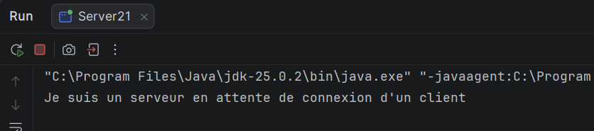
Interprétation : le serveur affiche "Je suis un serveur en attente de connexion d'un client" et reste bloqué sur `accept()`.

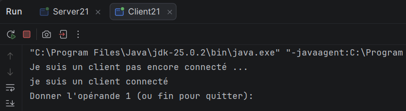
Interprétation : le client se connecte, affiche "je suis un client connecté" puis demande l'opérande 1.

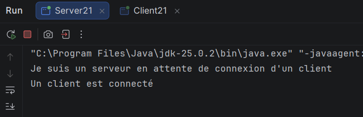
Interprétation : côté serveur, "Un client est connecté" apparaît au moment où `accept()` se débloque.

#### Test de l'addition
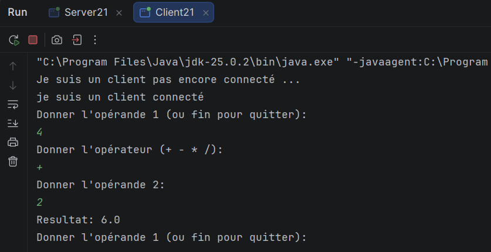
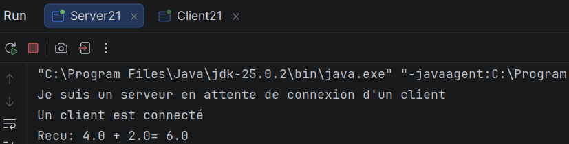

Interprétation : pour 4 + 2, le client affiche `Resultat: 6.0`. Le serveur affiche `Recu: 4.0 + 2.0= 6.0`.

#### Test de la soustraction
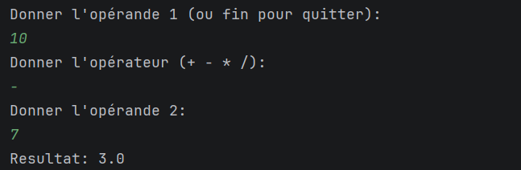

Interprétation : pour 10 - 7, le client affiche `Resultat: 3.0`. Le calcul est bien fait côté serveur.

#### Test de la multiplication
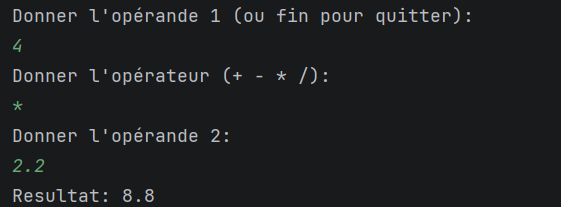

Interprétation : pour 4 * 2.2, le client affiche `Resultat: 8.8`. Les nombres décimaux sont bien acceptés.

#### Test de la division
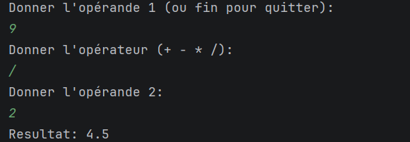
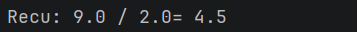

Interprétation : pour 9 / 2, le client affiche `Resultat: 4.5`. Comme les opérandes sont convertis en `double`, la division est réelle et non entière.

#### Test de la division par zéro
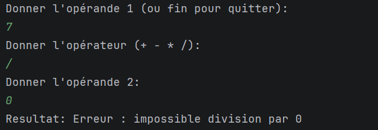
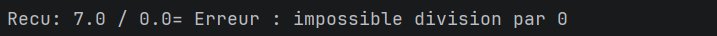

Interprétation : pour 7 / 0, le serveur détecte `b == 0` et renvoie `Erreur : impossible division par 0` à la place d'un résultat infini. Le serveur ne plante pas.

#### Test de fin : arrêt de la communication
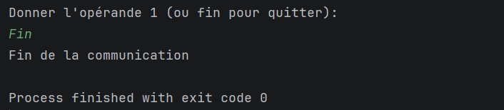
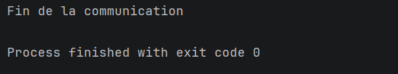

Interprétation : quand l'utilisateur saisit `fin`, le client envoie `FIN` puis sort de la boucle et affiche "Fin de la communication". Le serveur reçoit `FIN`, affiche "Fin de la communication" et sort de la boucle. Les deux processus se terminent avec `exit code 0`.

### Fermeture des sockets
Je n'ai pas écrit `socket.close()` : les sockets et les flux sont déclarés dans les parenthèses du `try-with-resources`, donc Java les ferme automatiquement à la sortie du bloc, même en cas d'exception.

### Remarques
- Le serveur doit toujours être lancé avant le client. Sinon, le client affiche `ConnectException: Connection refused`.
- Si le client se déconnecte sans envoyer `FIN`, `readLine()` retourne `null` : le serveur affiche "Le client s'est déconnecté" et s'arrête proprement.
- Si une opérande n'est pas un nombre (par exemple `abc`), le serveur capture `NumberFormatException` et renvoie `Erreur: opérande invalide`.
- Si l'opérateur est incorrect (par exemple `**`), le client affiche "Opérateur incorrect, réessayez." sans rien envoyer au serveur.

## Activité 2-2 : Échange des objets entre Client/Serveur via les Sockets TCP

### Étape 1 : Préparation de l'espace de travail
Je continue dans le même projet. J'ai créé un nouveau package `communPackage` qui contient la classe `Operation`, et deux nouvelles classes `Server22` (package `serverPackage`) et `Client22` (package `clientPackage`). 

### Étape 2 : Implémentation de l'échange d'objets

#### Principe
Dans l'activité 2-1, le client envoyait l'opération en trois lignes de texte. Maintenant, il envoie **un seul objet** qui contient les trois éléments de l'opération.

- La classe `Operation` contient le premier opérande, l'opérateur et le deuxième opérande. Elle implémente l'interface `Serializable`, qui autorise la transformation de l'objet en octets pour le transmettre sur le réseau.
- Le client lit les valeurs au clavier, vérifie la syntaxe, crée un objet `Operation` et l'envoie avec `writeObject()`.
- Le serveur reçoit l'objet avec `readObject()`, récupère ses données avec les getters, calcule le résultat et le renvoie au client.
- Le client lit le résultat avec `readObject()` et l'affiche.
  J'utilise des flux de traitement d'objets :
- **Écriture** : `OutputStream` → `ObjectOutputStream`, avec `writeObject()` pour envoyer un objet.
- **Lecture** : `InputStream` → `ObjectInputStream`, avec `readObject()` pour reconstruire l'objet reçu. Cette méthode retourne un `Object`, donc on fait un cast : `(Operation) in.readObject()`.

  La classe `Operation` doit avoir exactement le même package et le même nom côté client et côté serveur. Sinon `readObject()` lève une `ClassNotFoundException`.

Le résultat est renvoyé sous forme de `String`, ce qui permet de renvoyer aussi les messages d'erreur (par exemple la division par 0).

Pour terminer, le client saisit `fin` : il envoie un objet `Operation` dont l'opérateur est `"FIN"`, et le serveur quitte sa boucle.

#### Ordre de création des flux
Dans cette activité, je crée d'abord `ObjectOutputStream`, puis `ObjectInputStream`, des deux côtés. Le constructeur de `ObjectOutputStream` envoie un en-tête, et celui de `ObjectInputStream` attend de recevoir l'en-tête de l'autre côté. Si les deux côtés créaient leur `ObjectInputStream` en premier, les deux programmes resteraient bloqués. Ce problème n'existait pas avec `DataInputStream` ou `BufferedReader`, dont le constructeur n'attend rien.

#### Lancement : le serveur d'abord, puis le client
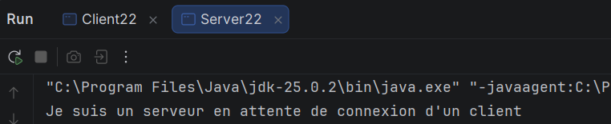
Interprétation : le serveur affiche "Je suis un serveur en attente de connexion d'un client" et reste bloqué sur `accept()`.

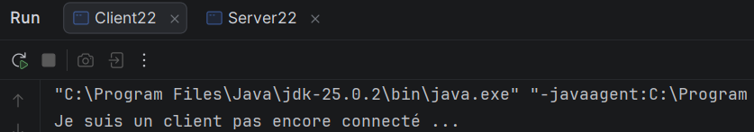
Interprétation : le client se connecte, affiche "je suis un client connecté" puis demande l'opérande 1.

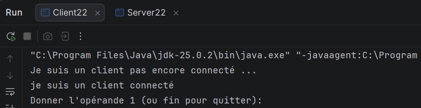
Interprétation : côté serveur, "Un client est connecté" apparaît au moment où `accept()` se débloque.

#### Test de l'addition
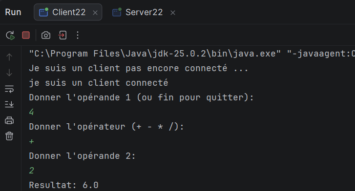
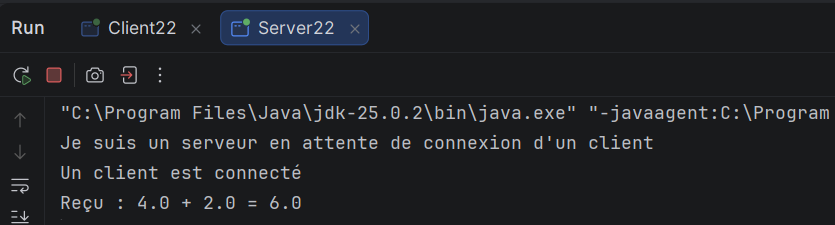

Interprétation : pour 4 + 2, le client envoie un objet `Operation`. Le serveur récupère ses données et affiche `Reçu : 4.0 + 2.0 = 6.0`. Le client affiche `Resultat: 6.0`.

#### Test de la soustraction
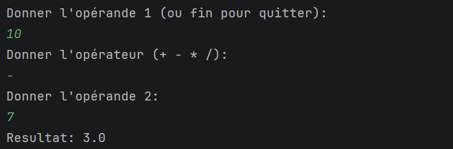
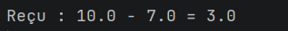

Interprétation : pour 10 - 7, le client affiche `Resultat: 3.0`.

#### Test de la multiplication
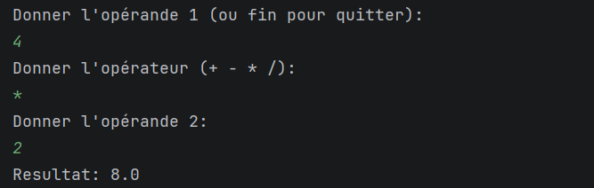
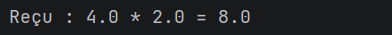

Interprétation : pour 4 * 2.2, le client affiche `Resultat: 8.8`. Les nombres décimaux sont bien acceptés.

#### Test de la division
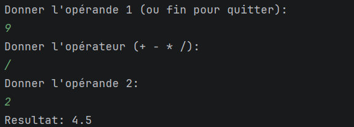
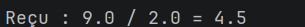

Interprétation : pour 9 / 2, le client affiche `Resultat: 4.5`. La division est réelle car les opérandes sont des `double`.

#### Test de la division par zéro
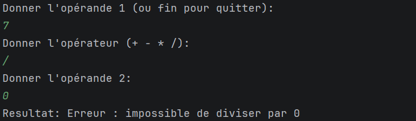
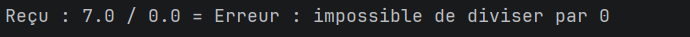

Interprétation : pour 7 / 0, le serveur détecte `b == 0` et renvoie `Erreur : impossible de diviser par 0`. Le serveur ne plante pas.

#### Test d'un opérateur incorrect
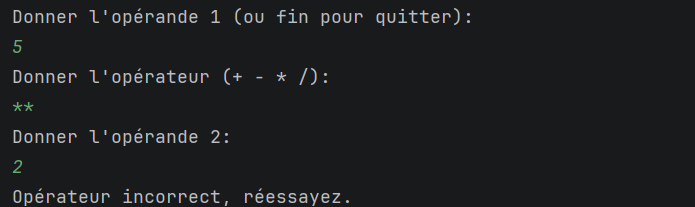

Interprétation : pour l'opérateur `**`, le client affiche "Opérateur incorrect, réessayez." et rien n'est envoyé au serveur.

#### Test d'une opérande invalide
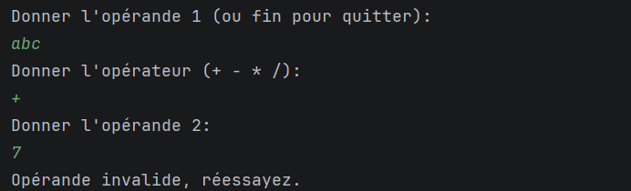

Interprétation : pour l'opérande `abc`, la conversion avec `Double.parseDouble()` échoue côté client. Le client affiche "Opérande invalide, réessayez." et rien n'est envoyé au serveur.

#### Test de fin : arrêt de la communication
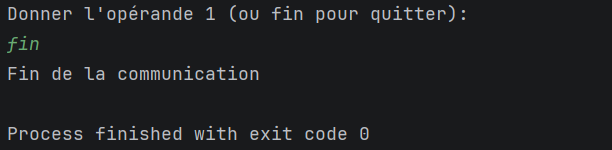
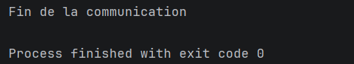

Interprétation : quand l'utilisateur saisit `fin`, le client envoie un objet `Operation` avec l'opérateur `FIN`, puis sort de la boucle et affiche "Fin de la communication". Le serveur reçoit cet objet, affiche "Fin de la communication" et sort de la boucle. Les deux processus se terminent avec `exit code 0`.

### Fermeture des sockets
Comme dans les activités précédentes, je n'ai pas écrit `socket.close()` : le socket et les flux sont déclarés dans le `try-with-resources`, donc Java les ferme automatiquement à la sortie du bloc.

### Remarques
- Le serveur doit toujours être lancé avant le client. Sinon, le client affiche `ConnectException: Connection refused`.
- La classe `Operation` doit être identique (même package, même nom) des deux côtés, sinon `readObject()` lève une `ClassNotFoundException`.
- Si le client se déconnecte sans envoyer `FIN`, `readObject()` lève une `EOFException` : le serveur affiche "Le client s'est déconnecté" et s'arrête proprement.
 